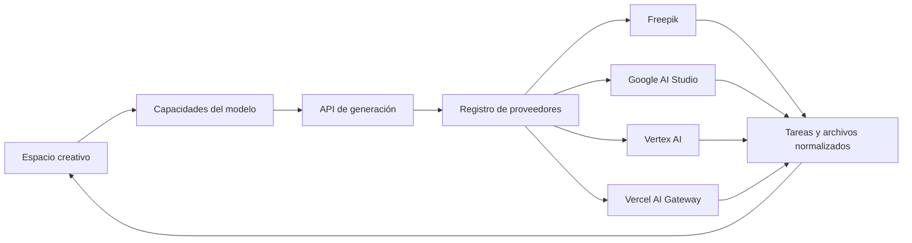

<div align="center">
  

  # Open-Higgsfield

  **La alternativa open source y multiproveedor a Higgsfield para generar imágenes y videos con IA.**

  Genera con modelos de Freepik, Gemini, Google Vertex AI y Vercel AI Gateway desde un único estudio creativo.

  <p>
    <a href="https://openhiggs.techbe.me"><strong>Demo en vivo</strong></a>
    |
    <a href="#por-qué-open-higgsfield">Funciones</a>
    |
    <a href="#proveedores-compatibles">Proveedores</a>
    |
    <a href="#inicio-rápido">Inicio rápido</a>
    |
    <a href="CONTRIBUTING.md">Contribuir</a>
  </p>

  <p>
    <a href="https://github.com/TechBeme/open-higgsfield/actions/workflows/ci.yml"></a>
    <a href="LICENSE"></a>
    <a href="https://nextjs.org"></a>
    <a href="https://www.typescriptlang.org"></a>
    <a href="https://github.com/TechBeme/open-higgsfield/stargazers"></a>
  </p>

  **Idiomas:** [🇺🇸 English](README.md) · [🇧🇷 Português](README.pt-BR.md) · 🇪🇸 Español

  <p>
    <a href="https://vercel.com/new/clone?repository-url=https%3A%2F%2Fgithub.com%2FTechBeme%2Fopen-higgsfield"></a>
  </p>
</div>


## ¿Por qué Open-Higgsfield?

Los modelos de medios generativos están repartidos entre proveedores, paneles y controles incompatibles. Open-Higgsfield los reúne en un único espacio visual:

- **Genera imágenes y videos en el mismo estudio** sin cambiar de producto.
- **Elige entre 40 modelos seleccionados** de Freepik, Google AI Studio, Vertex AI y Vercel AI Gateway.
- **Usa los controles correctos para cada modelo**: aspecto, resolución, duración, seed, CFG, seguridad y audio.
- **Trabaja naturalmente con referencias** mediante image-to-image, image-to-video, fotograma inicial/final, video y audio.
- **Cambia de proveedor sin reaprender la interfaz** con tareas, progreso, errores y resultados normalizados.
- **Usa tus propias claves y controla la stack** con una aplicación Next.js MIT y autohospedable.

## Capturas de pantalla

| Descubrimiento de modelos | Controles adaptativos |
| --- | --- |
|  |  |

### Espacio unificado de generación


## Proveedores compatibles

| Proveedor | Imágenes | Videos | Autenticación |
| --- | ---: | ---: | --- |
| Freepik | 7 | 16 | `FREEPIK_API_KEY` |
| Google AI Studio | 3 | 1 | `GEMINI_API_KEY` |
| Google Vertex AI | 2 | 1 | Credenciales de Google Cloud |
| Vercel AI Gateway | 5 | 5 | `AI_GATEWAY_API_KEY` |

El catálogo incluye Gemini Image, Veo, Flux, Recraft, GPT Image, Kling, Wan, Runway, Seedance, Seedream, PixVerse, LTX, MiniMax, Z-Image y OmniHuman. La disponibilidad, los precios, las cuotas y el acceso preview dependen de cada proveedor.

Consulta [Proveedores y modelos](docs/providers.md) para credenciales e instrucciones de extensión.

## Funciones

- Generación prompt-to-image y prompt-to-video
- Flujos image-to-image e image-to-video
- Referencias de fotograma inicial, final, personaje, movimiento, video y audio
- Controles de aspecto, tamaño, resolución, duración, seed, CFG, estilo y seguridad por modelo
- Audio nativo y múltiples escenas cuando están disponibles
- Entradas mediante arrastrar y soltar, pegar, subir archivos y URL pública
- Tareas síncronas y asíncronas normalizadas
- Progreso en vivo, reutilización de prompts, vista previa y descargas
- Interfaz adaptable para escritorio y móvil
- Credenciales disponibles únicamente en el servidor
- Despliegue local, con Docker y en Vercel

## Stack tecnológica

[](https://nextjs.org/)
[](https://react.dev/)
[](https://www.typescriptlang.org/)
[](https://tailwindcss.com/)
[](https://vercel.com/)

Next.js App Router, React 19, TypeScript estricto, Tailwind CSS 4, Framer Motion, Freepik API, Google Gen AI SDK, Vertex AI y Vercel AI Gateway.

## Arquitectura



La interfaz lee las capacidades de los modelos. El backend convierte cada solicitud en parámetros canónicos, resuelve el adaptador y normaliza resultados síncronos u operaciones asíncronas en el mismo formato de tarea. Consulta [Arquitectura](docs/architecture.md).

## Inicio rápido

### Requisitos previos

- Node.js 22+
- npm 10+
- Credenciales de al menos un proveedor
- Cloudinary únicamente para flujos que requieren URLs públicas de referencia

```bash
git clone https://github.com/TechBeme/open-higgsfield.git
cd open-higgsfield
npm install
cp .env.example .env.local
npm run dev
```

Configura únicamente los proveedores que quieras usar:

```dotenv
FREEPIK_API_KEY=
GEMINI_API_KEY=
GOOGLE_CLOUD_PROJECT=
GOOGLE_CLOUD_LOCATION=global
GOOGLE_SERVICE_ACCOUNT_JSON=
AI_GATEWAY_API_KEY=
CLOUDINARY_URL=

# Opcionales: también puedes conectarlos desde el panel de APIs
OPENROUTER_API_KEY=
ELEVENLABS_API_KEY=
HIGGSFIELD_API_KEY=
API_MARKET_API_KEY=
```

Abre [http://localhost:3000](http://localhost:3000). Copia el código de instalación que aparece en la terminal (caduca a los 30 minutos), crea tu contraseña y guarda el código de recuperación que se muestra una sola vez. Después abre **Menú → APIs** para añadir OpenRouter, OpenAI, ElevenLabs, Higgsfield, APIMart o productos de API.market desde la interfaz. No necesitas una contraseña de administrador en `.env.local`.

Para editar imágenes con IA, conecta **OpenRouter** en **APIs**, abre cualquier imagen de la galería y pulsa **Editar con IA**. El editor ofrece GPT Image 2.5 Sunburst o Flare cuando la conexión los tenga disponibles con imágenes de referencia. Puedes describir un cambio para toda la imagen, adjuntar una referencia o pintar una zona como guía visual. OpenRouter no expone una máscara nativa en su API de imágenes: la zona pintada se envía como una segunda imagen marcada en rojo y el modelo podría modificar otras partes. Cada resultado se guarda como una versión nueva junto a la original en el lienzo, lista para comparar visualmente o descargar. Las generaciones consumen créditos de OpenRouter; consultar el catálogo no genera imágenes.

**Menú → Editar imágenes** abre un lienzo vacío. **Agregar imagen** muestra la galería y permite elegir una imagen existente o subir una nueva. Las versiones aparecen como imágenes directamente sobre el lienzo, sin tarjetas ni bordes; pasa el cursor sobre una para ver su nombre y descargarla, o haz clic para editar desde esa versión. La herramienta **Mano** permite arrastrar el lienzo con el ratón; al elegir Pintar, Borrar o Comentarios, el arrastre se desactiva para que esos gestos actúen sobre la imagen. El panel derecho muestra los controles de la herramienta elegida. Los controles flotantes permiten ampliar o reducir el lienzo entre 50 % y 250 % y restablecerlo al 100 %. También puedes hacer zoom con el gesto de pellizcar en el panel táctil o con Ctrl/Cmd y la rueda del ratón. Puedes pintar una zona para retocarla, pintar objetos para borrarlos y reconstruir el fondo, añadir hasta ocho comentarios numerados sobre distintas zonas y quitar el fondo completo. Los comentarios y las marcas se envían como referencias visuales a OpenRouter; no son máscaras de edición exacta.

El modo **Audio** permite diseñar voces y guardar clones con ElevenLabs, o probar una clonación por solicitud con OpenRouter (Fish Audio o Seed Audio, según disponibilidad). Las voces guardadas generan locuciones y pueden utilizarse en el nodo **Generar audio** de workflows. Para clonar, usa solo grabaciones sobre las que tengas derechos y consentimiento. Las muestras se envían al proveedor elegido, pero no se guardan en el servidor local; los resultados sí se conservan de forma privada. En EasyPanel, monta un volumen persistente para `OPEN_HIGGSFIELD_STORAGE_DIR`, porque ahí viven las conexiones cifradas y los archivos de audio; la base de datos opcional no sustituye ese volumen.

En APIMart solo necesitas una clave: la aplicación consulta su catálogo y muestra los modelos visuales de imagen y vídeo disponibles para esa cuenta. No requiere `workspace` ni `slug`. API.market es un servicio distinto: allí puedes guardar una clave, buscar productos con suscripción activa y seleccionar varios modelos, o añadir un producto por su URL MCP. Las claves se guardan cifradas en el servidor; no uses `NEXT_PUBLIC_` para secretos. Consulta [Administración y EasyPanel](docs/admin-setup.md) para persistencia, recuperación, migración y límites de compatibilidad.

### Docker

```bash
cp .env.example .env.local
docker compose up --build
```

## Despliegue en Vercel

Usa el botón **Deploy with Vercel** de la parte superior y añade únicamente las credenciales de los proveedores que quieras habilitar. Configura `DATABASE_URL` para conservar el historial y las imágenes generadas en PostgreSQL/Neon. Las cargas temporales, los videos y los workers asíncronos todavía requieren object storage y colas duraderas. Consulta [Despliegue](docs/deployment.md).

> [!WARNING]
> Open-Higgsfield usa una contraseña de administrador para proteger las conexiones de proveedores, pero todavía no incluye autenticación de usuarios finales, rate limiting ni límites de gasto por usuario. Protege los despliegues públicos conectados a cuentas facturables.

## Comandos

| Comando | Propósito |
| --- | --- |
| `npm run dev` | Inicia el servidor de desarrollo |
| `npm run lint` | Ejecuta ESLint |
| `npm run typecheck` | Comprueba TypeScript |
| `npm run build` | Crea el build de producción |
| `npm run check` | Ejecuta lint, typecheck y build |
| `npm start` | Sirve el build de producción |

## Documentación

- [Proveedores y modelos](docs/providers.md)
- [Arquitectura](docs/architecture.md)
- [Despliegue](docs/deployment.md)
- [Cómo contribuir](CONTRIBUTING.md)
- [Política de seguridad](SECURITY.md)

## Cómo contribuir

Lee [CONTRIBUTING.md](CONTRIBUTING.md), crea una rama enfocada, ejecuta `npm run check` y abre un pull request. Si el proyecto te resulta útil, **dale una estrella al repositorio** y comparte lo que construyes.

## Seguridad y aviso legal

No informes vulnerabilidades en issues públicas. Open-Higgsfield es independiente y no está afiliado a Higgsfield AI, Freepik, Google, Vercel ni proveedores de modelos. Eres responsable de los costes, el contenido generado, la seguridad y el cumplimiento legal.

## Licencia

Publicado bajo la [Licencia MIT](LICENSE).

---

<div align="center">

**Developed by [Rafael Vieira](https://github.com/TechBeme)**

[](https://github.com/TechBeme)
[](https://www.fiverr.com/tech_be)
[](https://www.upwork.com/freelancers/~01f0abcf70bbd95376)
[](mailto:contact@techbe.me)

</div>
